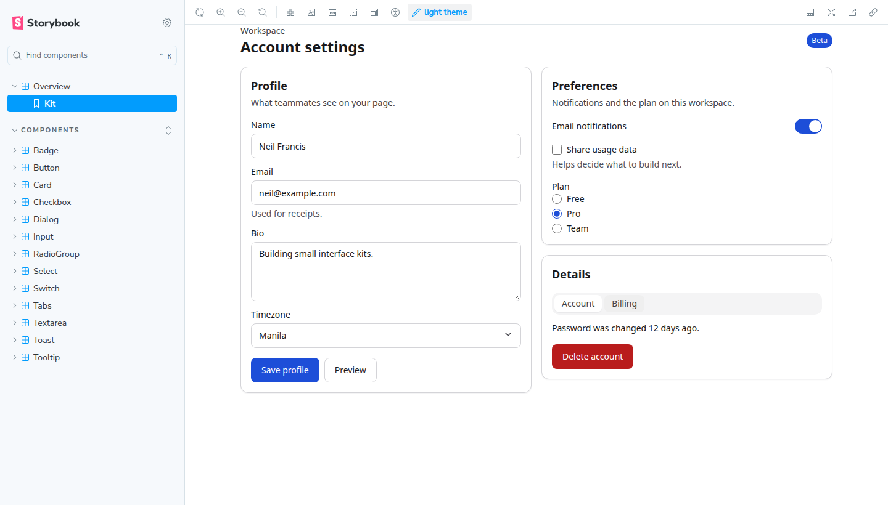

# react-ui-kit

A small React component library for my own projects. It covers the usual controls: buttons, form fields, dialogs, tabs and toasts. Components are keyboard accessible, and the theme has a light and a dark mode.



Live Storybook: https://react-ui-kit-nfsmaapoy.vercel.app

That URL is a placeholder. Replace it after the Vercel project is connected. `vercel.json` already tells Vercel to build Storybook.

## Install

React 19 is a peer dependency. The package is ready to publish as `react-ui-kit`. Until then, install it from this repo or link a local build.

```bash
npm install react-ui-kit
```

```tsx
import { Button, Input, ToastProvider, useToast } from 'react-ui-kit';
import 'react-ui-kit/styles.css';

function SaveButton() {
  const { toast } = useToast();

  return (
    <Button
      onClick={() =>
        toast({ title: 'Saved', description: 'Profile updated.' })
      }
    >
      Save
    </Button>
  );
}

export function ProfileForm() {
  return (
    <ToastProvider>
      <form>
        <Input label="Email" name="email" type="email" hint="We send receipts here." />
        <SaveButton />
      </form>
    </ToastProvider>
  );
}
```

Put `class="dark"` on a parent element to switch themes. Color, spacing, radius and type tokens are CSS variables in the stylesheet, prefixed with `--rui-`.

## Why these choices

I kept the stack small on purpose. React 19 with strict TypeScript makes the public props easier to trust. Vite in library mode outputs one ESM file and the type definitions, which is all this package needs. Tokens live in one stylesheet, so dark mode is a class on a parent instead of a second theme file. I write most of the components myself so the markup stays obvious. Dialog, Select and Tooltip use Radix, because focus trapping and listbox keyboard support are easy to get wrong. Storybook 9, with the a11y addon, is where I review states. Vitest and Testing Library check behavior.

## Local development

```bash
npm install
npm run storybook
```

| Command | What it does |
| --- | --- |
| `npm run storybook` | Storybook on port 6006 |
| `npm run test` | Vitest |
| `npm run lint` | ESLint |
| `npm run typecheck` | `tsc --noEmit` |
| `npm run build` | ESM bundle, CSS and `.d.ts` in `dist` |
| `npm run build-storybook` | Static Storybook in `storybook-static` |

Components: Button, Input, Textarea, Select, Checkbox, RadioGroup, Switch, Badge, Card, Dialog, Tooltip, Tabs and Toast.
